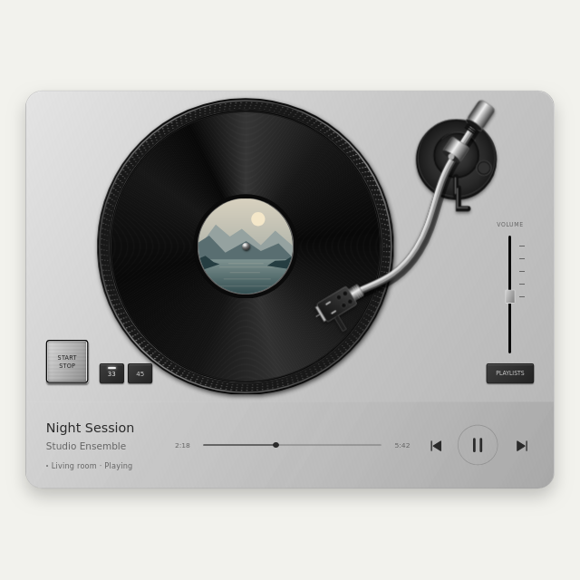
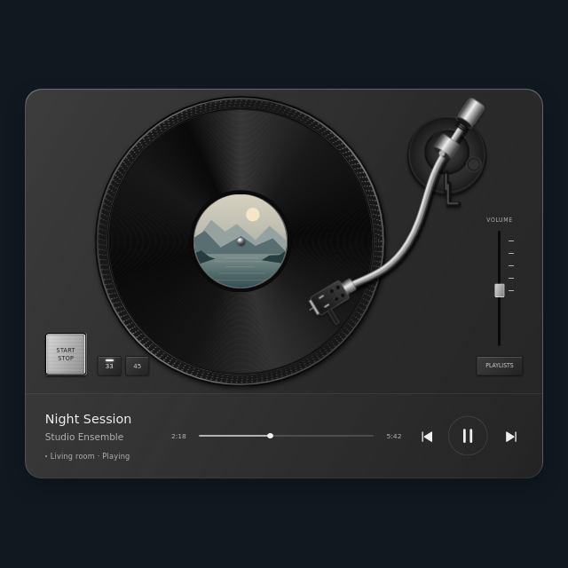
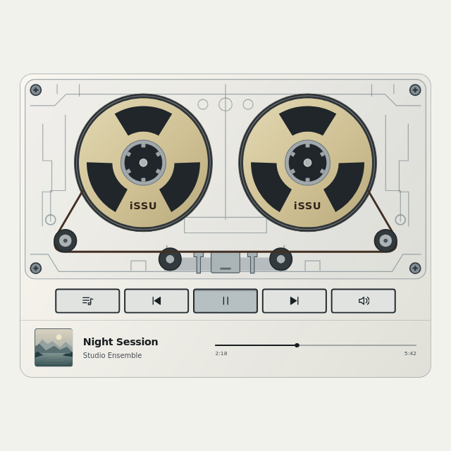

<div align="center">

[](#project-status)
[](https://www.home-assistant.io/)
[](#installation)
[](LICENSE)

**A turntable and cassette music card for Home Assistant.**

VinylMatrix brings album artwork and animated turntable or cassette mechanisms to your dashboard. Configure your media players once; the card follows the one that is playing.

</div>

---

## Project Status

| Field | Current state |
|---|---|
| **Maturity** | 🟢 Stable |
| **Used in my homelab** | ✅ Regular use in Home Assistant |
| **Recommended for everyday use** | ✅ For the documented features |
| **Setup difficulty** | 🟡 Intermediate — custom repository |
| **Documentation** | ✅ Installation, configuration and development |
| **Current version** | `1.1.2` — stable ([release](https://github.com/issu-lab/vinylmatrix-card/releases/tag/v1.1.2)) |
| **Validation** | Automated logic, packaging and browser checks; see [development](docs/development.md#release-112) for release evidence. The maintainer reports playlist playback works; targeted player edge cases and Marketplace installation/migration on 2026.11 remain to be verified. |
| **Distribution** | Custom repository: Marketplace on Home Assistant 2026.11+, HACS on earlier versions; not in the shared default catalog |

Version 1.1.2 includes the corrected preview filenames and README links. Version 1.1.1 refines playlist placement in every theme, renames the styles and refreshes the gallery. Version 1.1.0 added Music Assistant playlists, the compact layout (then named Minimal Small), slower vinyl animation and Marketplace installation instructions. Existing card configurations remain valid. The original themes and controls have been used regularly in Home Assistant since the first stable release; targeted playlist edge cases and the 2026.11 migration still need live validation. Automated checks do not establish compatibility with every player, browser or Home Assistant version.

---

## Why It Exists

Music deserves a recognizable place on a dashboard. VinylMatrix combines the familiar movement of a record player with a compact interface that puts album artwork first.

It works with existing Home Assistant media players, keeping the same experience across different devices and music integrations.

---

## Features

- 🎵 Album artwork, track title, artist and active player.
- 🔄 Automatic selection from an ordered list of media players.
- 💿 Rotating record and a tonearm that follows track progress, returning to rest when playback stops or pauses.
- 🎛️ Play/pause, previous/next, volume and seeking when supported by the player.
- 📼 Transparent Tape Deck style with rotating reels, lifting playback heads and compact artwork/progress.
- 📚 Music Assistant playlist picker with search, artwork and explicit playback destination.
- 🎨 Four selectable styles with automatic, light and dark colors.
- 🖱️ Visual configuration editor and YAML support.
- 🌍 English and Italian, with automatic language selection.
- ♿ Keyboard controls, accessible labels and reduced-motion support.

The card is standalone: it does not require other custom cards, external fonts or a separate music provider account.

---

## How It Works

The playing player takes priority. If several players are playing, VinylMatrix keeps the one already displayed; on first load, the first playing entry in the configured list wins.

When nobody is playing, the last available player remains visible so its artwork and resume control stay accessible. If that player becomes unavailable, the card falls back to the first available configured entry. If all are unavailable, it shows an unavailable state.

The record rotates only during `playing`. Vinyl, Minimal and SL1200 at its default 33 setting share a relaxed 12-second revolution. In both Vinyl and SL1200, the arm gradually moves from the outer grooves toward the label as the track advances, stopping short of the artwork. It follows position updates after seeking and the selected player when playback changes devices. Radio streams or tracks without a usable duration/position keep a fixed playing position.

The arm returns to its support during pause, idle, buffering or unavailability. Reduced motion disables spinning and makes the arm change position without animation.

Minimal keeps a stationary square sleeve on the left, with part of the spinning vinyl visible behind it. Track information, progress and essential controls sit on the right; volume expands below. It supports the same light, dark and automatic color modes.

In Tape Deck, both reels rotate while playing and the playback heads rise to the tape. Pause, stop, buffering and unavailable states stop the reels and lower the heads. Reduced motion disables reel rotation and makes the heads move instantly. The four rectangular buttons control previous track, play/pause (or stop when supported instead), next track and volume.

Selection itself sends no commands. Playback controls target the displayed entity, and a seek or volume gesture is canceled if the active player changes. Seeking is also canceled when the track changes.

---

## Interface

**Theme names in 1.1.1:** the editor uses the names below. Saved YAML identifiers stay unchanged to avoid switching existing dashboards to a different layout.

| New display name | Previous name | YAML `theme` value |
|---|---|---|
| Vinyl | Minimal | `minimal` |
| SL1200 | Classic | `classic` |
| Tape Deck | Cassette | `cassette` |
| Minimal | Minimal Small | `minimal_small` |

The eight previews below show version 1.1.1, with the Playlist button visible in every theme and color variant. Each 640 × 640 screenshot shows the actual card with sample artwork and simulated Music Assistant; its original proportions are preserved.

| Light | Dark |
|---|---|
| **Vinyl · default**<br> | **Vinyl · default**<br> |
| **SL1200**<br> | **SL1200**<br> |
| **Tape Deck**<br> | **Tape Deck**<br> |
| **Minimal**<br> | **Minimal**<br> |

**Vinyl** puts the record and artwork first. **Minimal** is a compact horizontal sleeve-and-record layout. **SL1200** adds a turntable base, S arm and physical controls. **Tape Deck** exposes the tape mechanism, with champagne-gold iSSU reels and four rectangular keys.

---

## Installation

The buttons below open VinylMatrix Card in your Home Assistant instance. Install or update to **1.1.2** to use Music Assistant playlists and the compact layout, then reload the browser to load the updated module.

### Marketplace — Home Assistant 2026.11 and later

Home Assistant's [Marketplace documentation](https://contributors.home-assistant.io/marketplace/how-it-works/) describes the built-in store under **Settings → Marketplace** starting with 2026.11. These instructions prepare for that transition; installation on 2026.11 has not yet been tested for this card.

<div align="center">

[](https://my.home-assistant.io/redirect/marketplace_repository/?owner=issu-lab&repository=vinylmatrix-card&category=plugin)

</div>

1. Open the button in your Home Assistant instance. A custom repository requires a GitHub connection.
2. Confirm adding `issu-lab/vinylmatrix-card` as a custom repository if prompted, then install the card. Its category is **Dashboard** (`plugin` in the link).
3. Reload the browser, edit a dashboard and choose **Add card → VinylMatrix Card**.
4. Select your media players and preferred style.

Marketplace registers the JavaScript module at `/local/community/vinylmatrix-card/vinylmatrix-card.js`, with a version query for cache refresh. If you manage resources in YAML, follow the resource instructions shown during installation. Use one resource entry for the card; do not add a second copy alongside an existing entry or `extra_module_url`.

VinylMatrix is a dashboard card, not a device integration. It is not included in the shared default catalog; installing a custom repository does not add it to that catalog.

### HACS — Home Assistant 2026.10 and earlier

With HACS already installed, use the compatible button:

<div align="center">

[](https://my.home-assistant.io/redirect/hacs_repository/?owner=issu-lab&repository=vinylmatrix-card&category=plugin)

</div>

If needed, open **HACS → ⋮ → Custom repositories**, add `https://github.com/issu-lab/vinylmatrix-card` with category **Dashboard**, then download it and reload the browser. Add VinylMatrix through the dashboard editor. The legacy resource is `/hacsfiles/vinylmatrix-card/vinylmatrix-card.js` (JavaScript module).

When upgrading to 2026.11, Marketplace takes over installed and custom repositories from HACS. Existing `/hacsfiles/` URLs remain supported; use `/local/community/` for manually maintained resources following the migration prompt. Do not reinstall HACS on 2026.11. The old `hacs_repository` button continues to work on both versions. See the [official migration details](https://contributors.home-assistant.io/marketplace/how-it-works/) and [repository links](https://contributors.home-assistant.io/marketplace/guides/catalog/).

### Manual installation

Download `vinylmatrix-card.js` from the [latest release](https://github.com/issu-lab/vinylmatrix-card/releases/latest), or build it from source:

1. Copy `vinylmatrix-card.js` (or `dist/vinylmatrix-card.js` after a local build) to Home Assistant's `www/` directory.
2. Add `/local/vinylmatrix-card.js` as a dashboard resource with type **JavaScript module**.
3. Refresh the browser, edit a dashboard and choose **Add card → VinylMatrix Card**.
4. Select your media players and preferred style in the visual editor.

Keep a copy of the dashboard configuration and any previous resource before replacing them. Restore those copies to roll back.

---

## Configuration

```yaml
type: custom:vinylmatrix-card
entities:
  - media_player.living_room
  - media_player.office
theme: minimal
color_mode: auto
language: auto
```

| Option | Default | Purpose |
|---|---|---|
| `entities` | Required unless `entity` is used | Ordered list of media player entity IDs. |
| `entity` | — | Single-player shorthand. `entities` takes precedence if both are present. |
| `name` | Player's friendly name | Optional player label; the track title stays separate. |
| `theme` | `minimal` | `minimal`, `minimal_small`, `classic` or `cassette`. |
| `show_playlists` | `true` | Show the playlist button when the Music Assistant integration is available. |
| `playlist_entity` | Automatic | Optional preferred Music Assistant player for playlist playback. |
| `color_mode` | `auto` | Follow Home Assistant, or force `light` / `dark`. |
| `language` | `auto` | Follow Home Assistant, or choose `en` / `it`. Other languages fall back to English. |

In the visual editor, search for a media player by friendly name or entity ID. Only `media_player` entities are offered; players already selected in another row are excluded. The row order defines startup priority.

Choose a style in the visual editor, or set `theme: cassette` / `theme: minimal_small` in YAML. Vinyl remains the default for existing and new configurations.

SL1200’s 33/45 buttons change the record animation speed only: 33 uses 12 seconds per revolution and 45 uses 8.8 seconds. These are decorative speeds. They do not change the playback speed of your audio.

Configurations saved with the retired `vinyl` or `ambient` style open Vinyl automatically.

### Music Assistant playlists

**Playlist controls in 1.1.1:** Vinyl places the icon-only Playlist button in the free lower-left control slot, restoring the full progress bar. SL1200 uses a text-only Playlist key inside the deck, at the lower-right corner beneath a shortened, aligned volume slider, with the same dark rectangular finish as the 33/45 keys. Tape Deck places five matching keys in the order Playlist, Previous, Play/Pause, Next, Volume, with Play/Pause centered. The compact Minimal uses the same five-control order, with an icon-only Playlist button beside Previous, centered Play/Pause and a full progress bar. Without Music Assistant or with playlists disabled, the original controls remain. A closed playlist panel uses no extra row.

With the official Music Assistant integration installed, a **Playlists** button appears in every theme. Open it to search your library, browse playlist artwork and load more results. The card uses your existing Home Assistant connection; no server URL, token, helper, script or additional custom card is needed.

Only players belonging to the Music Assistant integration can receive playlists. The initial destination is the active Music Assistant player, otherwise the first available Music Assistant player in the configured list. The destination is shown in the panel and remains fixed while it is open, even if the card switches to another playing entity. You can choose another configured Music Assistant player in the panel. Multiple Music Assistant servers are supported: the library follows the selected player's integration instance.

Choose a preferred player in the visual editor or set `playlist_entity`. It can be outside `entities`; add it to `entities` as well if you want the card's artwork and transport controls to follow it after starting playback. An invalid preferred player never silently redirects playback to a different speaker. Home Assistant's native selector filters this field to Music Assistant media players; the standalone fallback lists media players and ownership is checked when opening the panel.

```yaml
type: custom:vinylmatrix-card
entities:
  - media_player.music_assistant_living_room
theme: minimal_small
show_playlists: true
playlist_entity: media_player.music_assistant_living_room
```

Selecting a playlist requests immediate playback and **replaces the chosen player's queue**. The panel states this before selection. To hide the feature, set `show_playlists: false` or disable it in the editor. Without Music Assistant, the button stays hidden and ordinary media-player controls continue to work.

The integration must provide [`music_assistant.get_library`](https://www.home-assistant.io/actions/music_assistant.get_library/) and [`music_assistant.play_media`](https://www.home-assistant.io/actions/music_assistant.play_media/), and your Home Assistant user must be allowed to read the entity registry and call these actions. This lists playlists saved in the selected Music Assistant library, not a global provider search. Loading, empty libraries, unavailable players and service errors are shown in the panel; requests time out without automatic playback retries.

For a single player without additional options:

```yaml
type: custom:vinylmatrix-card
entity: media_player.living_room
```

---

## Known Limitations

- The stable designation is based on regular Home Assistant use and automated regression tests. Compatibility with every media player integration or Home Assistant version is not guaranteed.
- Browser scenarios run in Chromium, with additional Vinyl layout checks in WebKit and shared tonearm/Tape Deck geometry, playback and motion checks in both engines. There is no exhaustive compatibility matrix covering physical devices and Home Assistant versions.
- Available controls depend on the features reported by the selected player. Unsupported controls are disabled.
- Live streams without a finite duration cannot seek. Missing duration or position is displayed as `—:—`.
- Unavailable cover images use a built-in placeholder. Artwork URLs are supplied by the media player integration.
- Commands sent to a grouped player may affect its group, according to the integration's behavior.
- General music/provider search, playlist editing, queue management, an equalizer and audio analysis are not implemented. The playlist picker only browses playlists in the selected Music Assistant library.
- Playlist playback is covered by simulated browser checks; end-to-end playback in a live Home Assistant dashboard remains pending. Live read-only checks confirmed the installed integration returns playlist names, URIs and artwork.

---

## Documentation

- [Development, architecture and validation](docs/development.md)
- [Branding sources and regeneration](source/README.md)
- [Roadmap](ROADMAP.md)
- [Changelog](CHANGELOG.md)

---

## License

Released under the [MIT License](LICENSE).

---

<div align="center">

This project is part of the **iSSU Open Homelab ecosystem**.

<a href="https://github.com/issu-lab/Open-Homelab">
  
</a>

</div>
